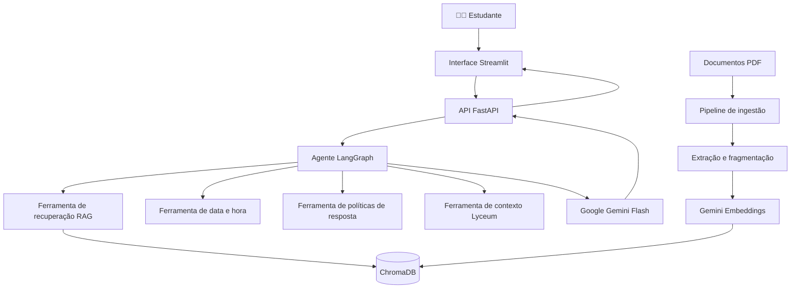

<div align="center">

# 🎓 Zélia
### Assistente Acadêmica Inteligente
Inteligência Artificial Generativa, RAG e agentes de IA aplicados ao atendimento universitário.

**🏆 Menção Honrosa — Mostra de Projetos Unijorge 2026**  
**Status:** MVP funcional | Em desenvolvimento

[Repositório](https://github.com/Fau-Pereira/rag-zelia) · [Reportar problema](https://github.com/Fau-Pereira/rag-zelia/issues)

</div>

---

## 📖 Sobre a Zélia

A **Zélia** é uma assistente virtual acadêmica baseada em Inteligência Artificial Generativa, desenvolvida para facilitar o acesso dos estudantes a informações e orientações institucionais.

Idealizada no contexto do **Centro Universitário Jorge Amado (Unijorge)**, a aplicação utiliza **Retrieval-Augmented Generation (RAG)** para consultar documentos acadêmicos e produzir respostas contextualizadas em linguagem natural.

O projeto integra processamento de documentos, busca semântica, modelos de linguagem e ferramentas de agentes de IA. Sua proposta é tornar a interação com informações institucionais mais simples, acessível e intuitiva.

---

## 🎯 Objetivos

- Facilitar o acesso a informações acadêmicas.
- Permitir consultas em linguagem natural.
- Recuperar informações de documentos institucionais.
- Apresentar respostas contextualizadas com indicação das fontes.
- Explorar arquiteturas RAG e agentes de Inteligência Artificial.
- Evoluir para uma experiência acadêmica personalizada e integrada aos sistemas institucionais.

> **Nota:** a Zélia encontra-se em desenvolvimento. A versão disponibilizada neste repositório é um MVP e não representa uma implantação institucional em produção.

---

## ✨ Funcionalidades

### Funcionalidades presentes no código

| Funcionalidade | Descrição |
| :--- | :--- |
| 💬 **Chat acadêmico** | Interface conversacional moderna desenvolvida em Streamlit com identidade visual interativa |
| 📚 **Consulta documental** | Recuperação de informações a partir de documentos PDF |
| 🔎 **Busca semântica** | Recuperação de fragmentos relevantes utilizando embeddings |
| 🧠 **Geração contextualizada** | Respostas produzidas com apoio do modelo Google Gemini (com fallback automático) |
| 🤖 **Agente de IA** | Orquestração de ferramentas com LangGraph |
| 📅 **Consulta de data** | Ferramenta para obter a data e hora do sistema em tempo real |
| 🛡️ **Política de respostas** | Ferramenta de consulta a respostas predefinidas para categorias de segurança |
| 🎓 **Contexto acadêmico (Lyceum)** | Conector e ferramenta para contextualização das respostas por curso e perfil do estudante |
| 🔗 **API REST & Observabilidade** | Endpoints para envio de perguntas (`/perguntar`), saúde (`/health`) e métricas de latência (`/metrics`) |
| 🗂️ **Ingestão documental** | Processamento idempotente de PDFs e persistência em banco vetorial |
| 💾 **Histórico da sessão** | Exibição das mensagens e personalização de estudante durante a sessão no Streamlit |

*A existência dessas funcionalidades no código não substitui testes contínuos de qualidade, segurança e desempenho em ambiente produtivo.*

---

## 🧰 Tecnologias Utilizadas

| Tecnologia | Finalidade |
| :--- | :--- |
| **Python** | Linguagem principal da aplicação |
| **FastAPI** | Desenvolvimento da API backend |
| **Uvicorn** | Servidor ASGI |
| **Streamlit** | Interface web conversacional |
| **LangChain** | Integração de componentes de IA |
| **LangGraph** | Orquestração do agente e suas ferramentas |
| **Google Gemini Flash** | Geração de respostas (`gemini-3.8-flash` / `gemini-2.5-flash` com fallback) |
| **Gemini Embedding 001** | Geração de embeddings (`gemini-embedding-001`) |
| **ChromaDB** | Banco de dados vetorial local |
| **Unstructured / PyPDF** | Extração de conteúdo de documentos PDF (com fallback automático) |
| **Python-dotenv** | Carregamento de variáveis de ambiente |
| **Pytest / Docker** | Suíte de testes automatizados e conteinerização |

O projeto também utiliza componentes para fragmentação textual, recuperação semântica e comunicação HTTP.

---

## 🏗️ Arquitetura do Sistema

A Zélia está organizada em três componentes principais:

1. **Pipeline de ingestão:** processamento dos documentos e construção da base vetorial.
2. **Backend e agente RAG:** recuperação de informações, orquestração de ferramentas e geração das respostas.
3. **Interface conversacional:** interação com o usuário por meio de uma aplicação web.

### Visão geral



### 1. Pipeline de ingestão de documentos

Implementado em `process_data.py`.

Responsável por:
- Localizar documentos PDF no diretório configurado.
- Extrair o conteúdo textual dos arquivos.
- Utilizar estratégias de extração adequadas ao documento, incluindo suporte a OCR (`UnstructuredPDFLoader`) e fallback automático (`PyPDFLoader`).
- Dividir o conteúdo em fragmentos (*chunks*).
- Gerar embeddings e IDs determinísticos (SHA-256) para evitar duplicidade.
- Armazenar os fragmentos no ChromaDB.

A implementação atual utiliza:
- `RecursiveCharacterTextSplitter`
- Tamanho dos fragmentos: **1.000 caracteres**
- Sobreposição: **200 caracteres**
- Processamento em lotes de **15 fragmentos**
- Pausas entre lotes e *retry* com *backoff* para reduzir problemas com limites de requisições

*O suporte a OCR depende também das bibliotecas e ferramentas externas instaladas no ambiente.*

### 2. Backend e agente de IA

Implementados em `main.py`, `rag_core.py` e `lyceum_client.py`.

O backend recebe requisições HTTP, valida os dados de entrada, mede a latência de execução, encaminha as perguntas ao núcleo de IA e devolve as respostas.

O núcleo RAG utiliza um agente LangGraph com ferramentas para:
- Pesquisar a base de conhecimento (`pesquisa_base_conhecimento`).
- Consultar a data e hora atuais (`consultar_data_atual`).
- Consultar respostas predefinidas de políticas de segurança (`consultar_politica_seguranca`).
- Consultar o contexto acadêmico e curso do estudante (`consultar_contexto_academico_lyceum`).

A ferramenta de recuperação consulta o ChromaDB e utiliza os documentos recuperados para fornecer contexto ao modelo de linguagem. A implementação configura a recuperação de até quatro documentos por consulta (`k=4`).

### 3. Interface conversacional

Implementada em `app.py`.

A interface Streamlit permite:
- Saudação personalizada com o nome do estudante e curso vinculado.
- Identidade visual interativa da Zélia (4 círculos concêntricos vermelhos em repouso e animação gradiente vermelho/azul durante o processamento).
- Enviar perguntas em linguagem natural ou selecionar sugestões rápidas.
- Visualizar mensagens do usuário e da Zélia.
- Manter o histórico da conversa durante a sessão.
- Limpar a conversa.
- Enviar perguntas ao backend FastAPI.

---

## 📂 Estrutura do Repositório

A estrutura principal do código publicado é:

```text
rag-zelia/
│
├── app.py
├── main.py
├── rag_core.py
├── lyceum_client.py
├── process_data.py
├── requirements.txt
├── lista_de_documentos.txt
├── Dockerfile
├── docker-compose.yml
├── .env.example
├── .gitignore
├── README.md
├── tests/
│   └── test_zelia.py
└── .github/
    └── workflows/
        └── ci.yml
```

Durante a configuração e execução, também são utilizados diretórios locais:

```text
rag-zelia/
│
├── documentos/   # PDFs utilizados na ingestão
├── chroma_db/    # Base vetorial persistida
├── .venv/        # Ambiente virtual Python
└── .env          # Credenciais locais
```

*Esses diretórios e arquivos locais não precisam estar presentes no repositório público.*

---

## ⚙️ Instalação e Configuração

### Pré-requisitos

Para executar a Zélia localmente, são necessários:
- Python 3.12 ou versão compatível com as dependências.
- Git.
- Acesso à internet.
- Chave de API do Google Gemini.
- Dependências Python especificadas em `requirements.txt`.

Para processamento de PDFs digitalizados via OCR, podem ser necessárias dependências adicionais do sistema, como Tesseract e Poppler.

> **Importante:** a instalação e execução devem ser validadas no ambiente de destino.

### 1. Clonar o repositório

```bash
git clone https://github.com/Fau-Pereira/rag-zelia.git
cd rag-zelia
```

### 2. Criar o ambiente virtual

**Linux / Ubuntu / macOS:**
```bash
python3 -m venv .venv
source .venv/bin/activate
```

**Windows — PowerShell:**
```powershell
py -m venv .venv
.\.venv\Scripts\Activate.ps1
```

### 3. Instalar as dependências

```bash
python -m pip install --upgrade pip
python -m pip install --no-cache-dir -r requirements.txt
```

Caso a instalação apresente erros, verifique a compatibilidade entre a versão do Python, o sistema operacional e as bibliotecas especificadas.

### 4. Configurar a chave de API

A Zélia utiliza a API do Google Gemini. Obtenha uma chave no [Google AI Studio](https://aistudio.google.com/).

Crie um arquivo `.env` na raiz do projeto (você pode usar `.env.example` como base):

```env
GOOGLE_API_KEY=sua_chave_de_api
```

O arquivo `.env` deve permanecer fora do controle de versão. Nunca publique credenciais, tokens ou chaves de API no GitHub.

### 5. Preparar os documentos

Crie o diretório `documentos` na raiz do projeto.

**Linux / macOS:**
```bash
mkdir -p documentos
```

**Windows — PowerShell:**
```powershell
New-Item -ItemType Directory -Force documentos
```

Adicione documentos PDF autorizados para utilização na aplicação. Exemplo:

```text
documentos/
│
├── manual_aluno.pdf
├── calendario_academico.pdf
└── orientacoes_academicas.pdf
```

*Os nomes são ilustrativos. **Atenção:** não utilize documentos contendo informações pessoais, confidenciais ou institucionais sem autorização.*

### 6. Processar os documentos

Com o ambiente virtual ativado, execute:

```bash
python process_data.py
```

O script realizará a extração do conteúdo, fragmentação, geração de embeddings e armazenamento no ChromaDB. O diretório padrão de persistência é `chroma_db/`.

Também é possível indicar caminhos personalizados:

```bash
python process_data.py --dir documentos --db chroma_db
```

> **Observação:** execute a ingestão antes de utilizar a Zélia em uma instalação nova, pois o mecanismo RAG depende de uma base vetorial com documentos processados.

### 7. Iniciar o backend

Abra um terminal com o ambiente virtual ativado:

```bash
uvicorn main:app --reload
```

- O backend ficará disponível, por padrão, em: `http://127.0.0.1:8000`
- A documentação interativa da API poderá ser acessada em: `http://127.0.0.1:8000/docs`

### 8. Iniciar o frontend

Abra um segundo terminal na pasta do projeto, ative novamente o ambiente virtual e execute:

```bash
streamlit run app.py
```

- A interface ficará disponível, por padrão, em: `http://localhost:8501`
- Mantenha o backend e o frontend em execução simultaneamente (ou utilize `docker compose up --build`).

---

## 💬 Como Utilizar

Após iniciar os serviços:
1. Abra a interface Streamlit no navegador.
2. Digite uma pergunta relacionada ao conteúdo dos documentos processados.
3. Aguarde a resposta da Zélia.
4. Consulte as referências documentais apresentadas, quando disponíveis.
5. Continue a conversa ou utilize a opção de limpar o histórico.

### Exemplos de perguntas
- *Quais são as regras para trancamento de matrícula?*
- *Onde encontro informações sobre faltas?*
- *O que o Manual do Aluno informa sobre avaliação?*
- *Quais orientações existem para solicitar serviços acadêmicos?*

As respostas dependerão do conteúdo disponível na base de conhecimento. A aplicação pode produzir respostas incorretas ou incompletas. Informações importantes devem ser conferidas nas fontes institucionais.

---

## 🔌 API REST

O backend disponibiliza os endpoints:
- `POST /perguntar` — Processa perguntas com RAG e contexto conversacional/acadêmico
- `GET /health` — Verificação de disponibilidade do serviço
- `GET /metrics` — Métricas de uso e latência média

### Exemplo de requisição

```bash
curl -X POST http://127.0.0.1:8000/perguntar \
  -H "Content-Type: application/json" \
  -d '{
    "query": "Quais são as regras para trancamento de matrícula?",
    "history": [],
    "student_name": "Fábio",
    "student_course": "Engenharia de Software"
  }'
```

### Estrutura esperada

```json
{
  "query": "Pergunta do usuário",
  "history": [
    {
      "role": "user",
      "content": "Mensagem anterior"
    }
  ],
  "student_name": "Fábio",
  "student_course": "Engenharia de Software",
  "student_registration": "20261001"
}
```

### Estrutura da resposta

```json
{
  "answer": "Resposta gerada pela Zélia",
  "latency_ms": 842.15
}
```

---

## 🧪 Testes e Validação

A Zélia foi apresentada e testada durante a **Mostra de Projetos da Unijorge de 2026**, e agora conta também com uma suíte automatizada de testes em `tests/test_zelia.py`.

Para executar os testes automatizados localmente:

```bash
pytest -v
```

### Verificações manuais recomendadas

| Verificação | Resultado esperado |
| :--- | :--- |
| **Inicialização da API** | Servidor FastAPI inicia sem erros |
| **Inicialização da interface** | Streamlit abre no navegador |
| **Processamento documental** | Documentos são incorporados ao ChromaDB |
| **Consulta RAG** | O sistema recupera informações pertinentes |
| **Resposta conversacional** | A API retorna uma resposta em JSON com `latency_ms` |
| **Histórico da conversa** | Mensagens são exibidas durante a sessão |
| **Limpeza do histórico** | A interface remove as mensagens da sessão |

### Recursos de qualidade de software implementados

- Testes unitários das ferramentas com `pytest`.
- Testes de integração da API (`POST /perguntar` e `GET /health`).
- Validação de segurança de entrada (bloqueio de *queries* vazias e *role spoofing*).
- Medição de latência por requisição (`latency_ms`) e endpoint `/metrics`.
- Automação de testes com GitHub Actions (`.github/workflows/ci.yml`).

---

## 🎯 Contexto do Projeto e Minha Atuação

### Origem da Zélia

A Zélia foi idealizada como uma proposta de utilização de Inteligência Artificial Generativa para aprimorar o acesso às informações e aos serviços acadêmicos. O projeto nasceu da identificação de uma oportunidade de desenvolver uma interface conversacional capaz de aproximar estudantes dos conteúdos institucionais.

Sua primeira versão foi concebida e desenvolvida como um MVP funcional, posteriormente apresentado ao **NITE — Núcleo de Inovação Tecnológica da Unijorge**. A partir dessa apresentação, o projeto passou por uma etapa de desenvolvimento colaborativo, envolvendo profissionais e estudantes com diferentes responsabilidades técnicas.

### 👨‍💻 Minha atuação

**Fábio Pereira — Idealizador | Líder Técnico | Desenvolvedor**

Fui responsável pela concepção da Zélia e pelo desenvolvimento de seu primeiro MVP, participando diretamente da definição da arquitetura, seleção das tecnologias e implementação da aplicação. Ao longo de sua evolução, também assumi responsabilidades de liderança técnica, coordenação da equipe e gerenciamento das entregas.

#### Concepção e arquitetura
- Idealização do projeto e definição da proposta inicial.
- Desenvolvimento do MVP apresentado ao NITE.
- Definição dos objetivos e requisitos iniciais.
- Planejamento da arquitetura da aplicação.
- Seleção das principais tecnologias.
- Condução das decisões técnicas.

#### Desenvolvimento de software e IA
- Participação direta na programação.
- Desenvolvimento de componentes em Python.
- Implementação e integração de recursos de IA.
- Participação na evolução da arquitetura RAG.
- Acompanhamento da integração entre os componentes da aplicação.

#### Liderança técnica
- Coordenação de três colaboradores durante o desenvolvimento.
- Planejamento e acompanhamento das entregas.
- Definição de prioridades técnicas.
- Acompanhamento da evolução das funcionalidades.
- Continuidade do desenvolvimento e manutenção do projeto.

### 👥 Colaboração no desenvolvimento

Durante sua evolução, a Zélia contou com três colaboradores que participaram de frentes específicas:

| Frente | Responsabilidade |
| :--- | :--- |
| **Orquestração** | Desenvolvimento de componentes relacionados à orquestração da IA |
| **Integração institucional** | Trabalho de integração com APIs de serviços acadêmicos |
| **Personalização** | Desenvolvimento de características de personalidade e comunicação da assistente |

As contribuições foram realizadas de forma colaborativa, sob coordenação técnica do idealizador. Atualmente, a manutenção e o desenvolvimento da Zélia estão concentrados em seu idealizador.

---

## 🏆 Reconhecimento Institucional

### Menção Honrosa — Mostra de Projetos Unijorge 2026

A Zélia foi apresentada e testada durante a **Mostra de Projetos da Unijorge de 2026**. O projeto recebeu **Menção Honrosa**, sendo reconhecido como um dos destaques da edição.

A participação no evento representou uma oportunidade de apresentar o MVP ao público, demonstrar sua proposta tecnológica e identificar possibilidades de evolução. Esse reconhecimento constitui um marco importante na trajetória do projeto.

---

## 🚀 Roadmap

A Zélia permanece em evolução contínua. As frentes abaixo contemplam as melhorias implementadas e a expansão institucional planejada:

### 🎨 Interface conversacional
**Status:** Implementado (Em evolução contínua)
- Reformulação visual da aplicação inspirada em assistentes contemporâneos e Playgrounds de IA.
- Saudação dinâmica personalizada com o nome do estudante e curso de matrícula.
- Logo interativa com 4 círculos concêntricos (vermelho em repouso e transição gradiente vermelho/azul durante o pensamento).
- Sugestões rápidas de perguntas e layout responsivo.

### 🎓 Integração com Lyceum
**Status:** Conector base implementado (`lyceum_client.py`) | Integração produtiva planejada
- Estrutura de conector (`obter_contexto_estudante`) e ferramenta do agente (`consultar_contexto_academico_lyceum`) prontas para contextualizar o atendimento por curso, semestre, modalidade e campus.
- A conexão em produção depende da disponibilidade das APIs institucionais (`LYCEUM_API_URL` e `LYCEUM_API_TOKEN`), das permissões institucionais e dos requisitos de segurança.

### 🤖 Personalização da IA
**Status:** Implementado (Em evolução contínua)
- Aprimoramento da personalidade conversacional.
- Personalização da comunicação conforme o curso e contexto acadêmico do estudante.
- Melhor gerenciamento do histórico da conversa (sem duplicação de mensagens) e fallback resiliente entre modelos Gemini.

### ⚙️ Engenharia e infraestrutura
**Status:** Implementado
- Conteinerização com Docker (`Dockerfile` e `docker-compose.yml`).
- Testes automatizados com `pytest` (`tests/test_zelia.py`).
- Integração contínua com GitHub Actions (`.github/workflows/ci.yml`).
- Melhorias no pipeline de ingestão (IDs determinísticos SHA-256, normalização de páginas e fallback de extração).
- Monitoramento e observabilidade (`/health` e `/metrics` com medição de latência).

---

## 🔐 Segurança e Privacidade

A Zélia é um projeto em desenvolvimento e não deve ser considerada pronta para processar dados acadêmicos pessoais em produção sem avaliações adicionais.

A evolução da aplicação contempla:
- Autenticação e autorização.
- Controle de acesso a informações institucionais.
- Proteção de credenciais.
- Minimização de dados pessoais.
- Tratamento adequado de documentos.
- Proteção contra exposição indevida de informações (tratamento seguro de erros HTTP 500 e validação estrita de payload).
- Testes de segurança e avaliação de respostas.
- Observância da Lei Geral de Proteção de Dados Pessoais (LGPD).

*Não utilize informações reais de estudantes ou documentos confidenciais em ambientes de demonstração sem autorização.*

---

## 🛠️ Solução de Problemas

- **Erro: `GOOGLE_API_KEY` não encontrada**  
  Verifique se o arquivo `.env` está na raiz do projeto e contém `GOOGLE_API_KEY=sua_chave`.

- **Erro: módulo Python não encontrado**  
  Verifique se o ambiente virtual está ativo e reinstale as dependências:
  ```bash
  python -m pip install --no-cache-dir -r requirements.txt
  ```

- **Erro ao consultar a Zélia**  
  Verifique se o backend FastAPI está em execução na porta `8000`.

- **Erro de conexão com o ChromaDB**  
  Confirme se os documentos foram processados e se o diretório `chroma_db` está acessível.

- **Erro durante a extração de PDFs**  
  O script faz fallback automático para `PyPDFLoader` caso dependências de OCR não estejam instaladas no sistema operacional.

- **Erro de limite de requisições / erro 503**  
  O pipeline de ingestão possui pausas e *retry* progressivo, e o núcleo RAG possui *fallback* automático entre modelos Gemini em caso de alta demanda nos servidores do Google.

---

## 🤝 Contribuições

Sugestões, correções e melhorias técnicas são bem-vindas. Para propor uma alteração:
1. Abra uma *issue* descrevendo a melhoria ou o problema.
2. Crie uma ramificação (*branch*) para o desenvolvimento.
3. Implemente e documente as alterações.
4. Verifique o funcionamento do código (`pytest -v`).
5. Envie um *pull request*.

*Contribuições relacionadas a integrações institucionais, dados acadêmicos ou credenciais dependem das autorizações correspondentes.*

---

## 📄 Licença e Uso

Este repositório disponibiliza código para consulta e colaboração técnica. As condições de reutilização, modificação e distribuição devem ser definidas em um arquivo de licença específico. Até que uma licença seja publicada, não se deve presumir autorização geral para reutilização do código. O uso de nomes, marcas, documentos e sistemas institucionais deve respeitar as autorizações aplicáveis.

---

## 👨‍💻 Idealização e Desenvolvimento

**Fábio Pereira**  
Idealizador, líder técnico e desenvolvedor da Zélia.  
*Áreas de atuação e interesse:* Python | Engenharia de Software | Inteligência Artificial | RAG | Agentes de IA | Engenharia de Dados  
[Perfil no GitHub](https://github.com/Fau-Pereira)

---

<div align="center">
🎓 <strong>Zélia</strong> — Inteligência Artificial para aproximar estudantes da informação.<br>
Projeto em desenvolvimento | Unijorge — Salvador, Bahia
</div>
